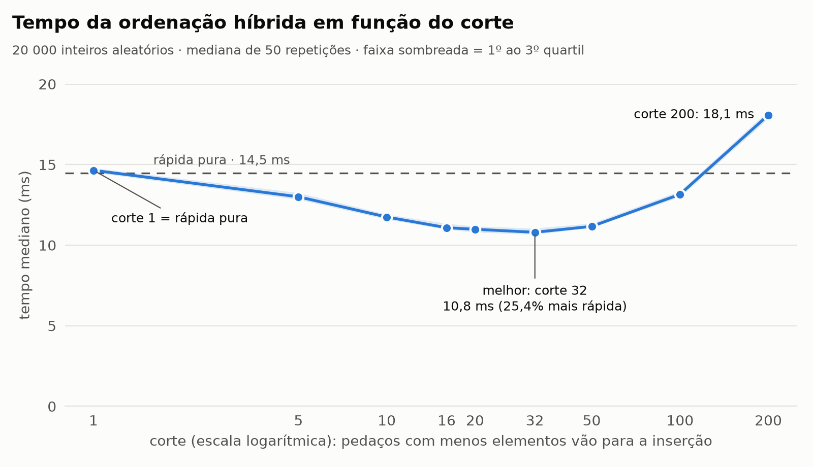

# Relatório: ordenação híbrida (rápida + inserção)

**Dupla:** Samuel Ribeiro Cardoso e Pedro Augusto

## O que foi feito

- **`ordenacao.py`**: três funções.
  - `insercao(v)`: ordenação por inserção.
  - `quicksort(v)`: rápida pura, com pivô aleatório (`random.choice`) e partição em três listas (**menores**, **iguais** e **maiores** que o pivô).
  - `quicksort_hibrido(v, corte)`: a mesma rápida, mas todo pedaço com **menos que `corte` elementos** é entregue à inserção.
- **`medir.py`**: mede os tempos e grava `resultados.csv`.
- **`grafico.py`**: gera `grafico_corte.png` a partir do CSV.
- **`test_ordenacao.py`**: testes de correção (lista vazia, já ordenada, invertida, só valores repetidos, aleatória etc.) para todos os cortes.

```python
def quicksort_hibrido(v, corte):
    if len(v) <= 1:
        return v
    if len(v) < corte:
        return insercao(v)
    pivo = random.choice(v)
    menores = [x for x in v if x < pivo]
    iguais = [x for x in v if x == pivo]
    maiores = [x for x in v if x > pivo]
    return quicksort_hibrido(menores, corte) + iguais + quicksort_hibrido(maiores, corte)
```

### Como foi medido

| | |
|---|---|
| Entrada | 20.000 inteiros aleatórios entre 0 e 1.000.000 |
| Repetições | 50. Em cada repetição sorteia-se uma lista nova, e **a mesma lista** é ordenada pelas 10 variantes (pura + 9 cortes), em ordem embaralhada |
| Medida | `time.perf_counter`, com o coletor de lixo desligado durante a ordenação. Reporta-se a **mediana** das 50 medições, e o intervalo entre o 1º e o 3º quartil (Q1–Q3) indica a dispersão |
| Conferência | toda saída é comparada com `sorted(v)`; nenhuma variante errou |
| Máquina | Apple M4, 16 GB, macOS, Python 3.14.5 |

A coluna "chamadas" conta quantas vezes cada função foi executada para ordenar uma lista fixa de 20.000 elementos, usando a mesma semente aleatória em todas as variantes.

## Resultados

| Variante | Corte | Mediana (ms) | Q1 – Q3 (ms) | Ganho sobre a pura | Chamadas da rápida | Chamadas da inserção |
|---|---:|---:|---:|---:|---:|---:|
| rápida pura | — | 14,48 | 14,37 – 14,70 | — | 26.483 | 0 |
| híbrida | 1 | 14,65 | 14,52 – 14,80 | −1,1% | 26.483 | 0 |
| híbrida | 5 | 13,00 | 12,84 – 13,25 | +10,2% | 13.217 | 3.952 |
| híbrida | 10 | 11,75 | 11,60 – 11,92 | +18,9% | 7.227 | 2.920 |
| híbrida | 16 | 11,09 | 10,98 – 11,34 | +23,5% | 4.777 | 2.081 |
| híbrida | 20 | 10,99 | 10,80 – 11,17 | +24,2% | 3.767 | 1.689 |
| híbrida | **32** | **10,80** | 10,67 – 11,06 | **+25,4%** | 2.385 | 1.121 |
| híbrida | 50 | 11,17 | 11,09 – 11,36 | +22,9% | 1.577 | 756 |
| híbrida | 100 | 13,16 | 13,00 – 13,36 | +9,2% | 815 | 396 |
| híbrida | 200 | 18,08 | 17,86 – 18,34 | −24,8% | 373 | 187 |

*Ganho positivo = mais rápida que a pura; negativo = mais lenta.*



A curva tem forma de **U**: o tempo cai enquanto o corte cresce até cerca de 32 e depois sobe rapidamente.

## Melhor corte e ganho sobre a rápida pura

O melhor tempo foi com **corte = 32**: **10,80 ms**, contra **14,48 ms** da rápida pura. São **3,7 ms a menos, ou seja, 25,4% mais rápida** (cerca de 1,34 vez mais veloz).

O fundo do U, porém, é **plano**. Os cortes 16, 20, 32 e 50 ficam todos entre 10,80 e 11,17 ms, e as faixas Q1–Q3 de 20 e 32 se sobrepõem. Na prática, qualquer corte entre 16 e 50 dá de 23% a 25% de ganho. Medindo de novo, o "vencedor" pode trocar entre 20 e 32, mas a região ótima continua a mesma.

**Por que ganha:** a maior parte das chamadas da rápida acontece no fundo da recursão, em pedaços minúsculos. Para ordenar 20.000 elementos, a pura faz 26.483 chamadas. Cada chamada tem um custo fixo alto: chamar a função, sortear o pivô, percorrer a lista três vezes e criar listas novas na concatenação. Num pedaço de 5 elementos isso é desperdício, porque a inserção resolve com uns poucos laços simples. Com corte 10, as chamadas da rápida caem de 26.483 para 7.227, mais 2.920 inserções baratas.

> Comparação: o `std::sort` do C++ (GCC) usa 16 como limite. Nosso ótimo ficou um pouco acima porque, nesta implementação em Python, cada chamada da rápida é especialmente cara (cria três listas novas). O ponto exato depende da linguagem, da implementação e da máquina.

## O que acontece com cortes grandes demais

A partir de 50, o tempo volta a subir: **13,16 ms com corte 100** e **18,08 ms com corte 200**. Com corte 200 a híbrida fica **24,8% mais lenta que a rápida pura** (e 67% mais lenta que o melhor corte).

O motivo é que a inserção é **O(k²)**. Um pedaço de k elementos em ordem aleatória custa em média cerca de k²/4 comparações e deslocamentos:

- **Custo da inserção:** há cerca de n/k pedaços de tamanho k, então o custo total da inserção é proporcional a n·k. Ele cresce **linearmente com o corte**. Com corte 200, cada uma das 187 inserções recebe em média uns 107 elementos.
- **Economia na rápida:** cada vez que o corte dobra, só se elimina mais **um** nível da recursão. A economia cresce como **log(corte)**.

Um termo linear sempre acaba vencendo um logarítmico. Depois do ponto ótimo, o tempo sobe quase em linha reta com o corte: cerca de 0,04 ms a cada unidade entre 50 e 100, e 0,05 ms entre 100 e 200. No limite, um corte maior que n (20.000) transforma tudo em inserção pura, de custo O(n²).

## Corte = 1 se comporta como a rápida pura

Isso foi confirmado de três maneiras:

1. **Pelo código:** o caso base `len(v) <= 1` vem antes do teste do corte. Com corte = 1, a condição `len(v) < 1` nunca é verdadeira, então a inserção nunca é chamada e o algoritmo executado é exatamente o da pura.
2. **Pela contagem de chamadas:** com a mesma semente, as duas fazem **26.483 chamadas** recursivas e **0** inserções.
3. **Pelo teste automatizado** (`test_corte_1_faz_as_mesmas_escolhas_que_a_pura`): partindo da mesma semente, as duas consomem exatamente a mesma sequência de números aleatórios. Portanto sorteiam os mesmos pivôs, na mesma ordem, e montam a mesma árvore de recursão.

**Pelo tempo:** 14,65 ms contra 14,48 ms, uma diferença de 0,16 ms (1,1%). As faixas Q1–Q3 se sobrepõem (14,52–14,80 contra 14,37–14,70). O pouco que sobra é o custo de testar `len(v) < corte` e de passar um parâmetro a mais em cada uma das 26 mil chamadas. Não é uma diferença de comportamento.

## Como reproduzir

```bash
python3 -m venv .venv && .venv/bin/pip install -r requirements.txt
.venv/bin/python -m unittest -v      # correção
.venv/bin/python medir.py            # tempos -> resultados.csv
.venv/bin/python grafico.py          # gráfico -> grafico_corte.png
```

Os números deste relatório vêm da execução registrada em `resultados.csv`. Uma nova execução regrava o CSV e o gráfico, e os tempos variam um pouco, mas este texto não é atualizado sozinho.
